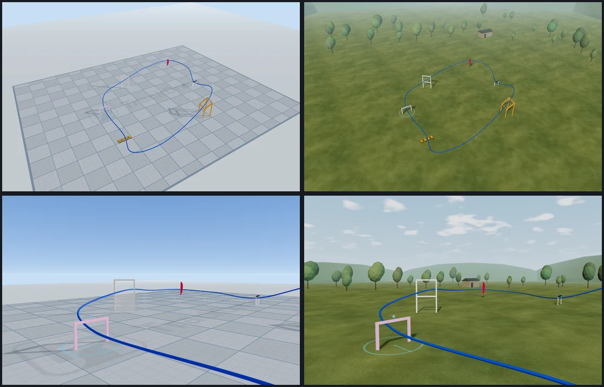
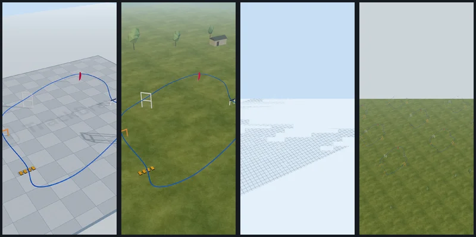
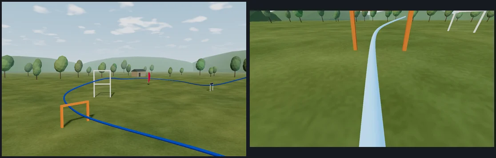

# Outdoor 3D presentation

[#1064](https://github.com/dutchdronesquad/trackdraw/issues/1064) adds one daylight field to the same TrackDraw 3D canvas used in Studio, shared tracks and embeds. The design grid stays the default. The view selector remembers a browser preference; the author's choice does not travel with projects, shares, exported JSON or portable snapshots. The standalone TrackDraw Viewer package can still open those snapshots with its own existing scene.

## Visual baseline

The [course and camera fixture](../../../tests/fixtures/presentation-course.ts) is reusable for [route quality #1063](https://github.com/dutchdronesquad/trackdraw/issues/1063) and [framing #1067](https://github.com/dutchdronesquad/trackdraw/issues/1067). This synthetic fixture includes a turn around a flag, a stacked opening, an elevation transition and an artificially textured gate. Its authored line was chosen for visual comparisons; it is not a validated race route. The stress fixture repeats the scene across a 400 × 195 m field with 105 items.

Each desktop row compares the design grid on the left and daylight on the right at the same camera pose. The first row is an overview, the second a low orbit angle.




The gate opening, ladder, flag and selection outline remain visible against the grass. Printed artwork remains subject to its existing orientation and asset loading. The landscape stays outside course framing, inventory, selection and course geometry. In the narrow viewport the fixed desktop camera crops the sides in both modes; adaptive framing is part of #1067.



## Output and quality

Opaque PNGs use the current canvas or the same landscape in the fitted renderer. Transparent PNGs keep the existing bounded design surface and omit the environment. WebM uses the shared landscape and renderer tone mapping; it retains the existing export's route tint, simpler course renderer and fixed 720p/60 fps output. Lighting and scenery are statically seeded, with no clock, random animation, remote HDRI or extra texture download. The landscape is rendered in the app and raster exports; archived track snapshots and future portable 3D models (#1042) do not include its scenery.



| Setting | Grass | Trees | Shadows | Preview resolution |
| --- | --- | --- | --- | --- |
| Design grid | Existing checker | None | Existing | Up to 2× device pixel ratio |
| Daylight | 256² RGBA plus mipmaps (~341 KiB) | 72 instanced | One 2048² map for the course | Up to 2× |
| Low detail | 128² RGBA plus mipmaps (~85 KiB) | 24 of the same trees, simpler crowns | Off | 1× |

Coarse pointer devices, fields wider than 180 m on either axis, and designs with at least 200 items automatically use low detail when daylight is selected. Users can also choose low detail directly. Terrain, sky and scenery are generated by TrackDraw code, with zero environment requests and no third party distribution rights to manage. No additional assets are needed for offline packaging. The scene owns its resources and disposes of its texture, shadow map, materials, geometry and instance buffers on removal; a scene setup error falls back to the grid.

**Evening: defer.** A warm sun and changed sky alone would make the grass and dark artwork harder to distinguish. A usable preset needs separate exposure and shadow tuning, a gate material model for illuminated panels, and another artwork, selection and export comparison at both quality levels. Budget roughly one to two engineering days for the material and preset pass, plus separate device and visual review.

## Measurements

Chrome on an Apple Silicon Mac, headless with the default GPU path. Medians over 40 frames at the fixed overview camera. All sampled frame intervals were 16.6–16.8 ms on this host. Draw calls include the shadow pass. CPU submission time does not measure GPU latency.

| View | Grid: calls / submit ms | Daylight: calls / submit ms | Explicit low: calls / submit ms |
| --- | ---: | ---: | ---: |
| Desktop Studio | 109 / 1.5 | 111 / 1.6 | 80 / 1.3 |
| Desktop Viewer | 100 / 1.5 | 102 / 1.4 | 71 / 1.7 |
| Desktop Viewer, large | 1016 / 3.6 | 767 / 3.3 | 767 / 3.3 |
| Pixel 7 emulation, Viewer | 91 / 1.4 | 62 / 1.2 | 62 / 1.1 |
| Pixel 7 emulation, Viewer, large | 667 / 3.4 | 418 / 2.4 | 418 / 4.2 |

Median synchronous scene construction was 3.4 ms full / 1.1 ms low over 20 fresh desktop allocations, excluding shader compilation. Three repeated toggle cycles per surface kept renderer texture and geometry counts bounded on return to the grid. The browser check also verifies the fixed pose, snapshot identity and persistence across reload. Physical mobile performance, heat and touch usability remain unverified; the Pixel 7 comparison tests viewport and quality selection on the Mac GPU.

Reproduce with Playwright available on Node's module path and Chromium installed. Set `CHROME_PATH` to use an installed Chrome and `PRESENTATION_ARTIFACTS` to choose the output directory.

```sh
RECORD_FLYTHROUGH=1 node tests/browser/outdoor-presentation.cjs
```
